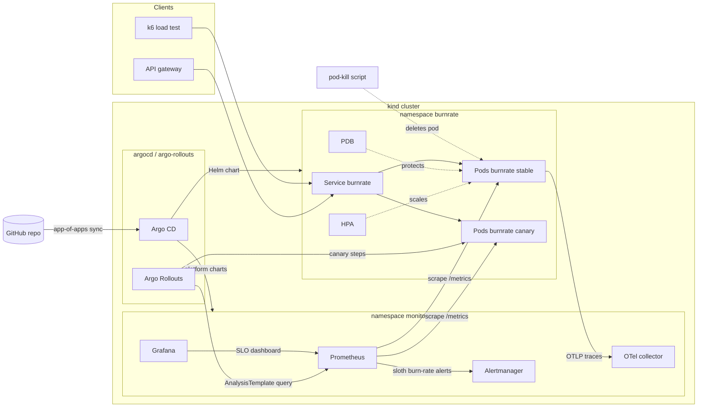

# BurnRate

[](https://github.com/Vrajesh-works/BurnRate/actions/workflows/ci.yml)

BurnRate is a rate-limiting decision service for payment APIs, written in Go and
run on Kubernetes the way a production SRE team would run it. API gateways ask
`POST /v1/check` "may merchant X spend N units on key Y right now?" and get a
token-bucket answer with a `Retry-After` hint. Around that small service sits the
platform: a hardened Helm chart with probes, HPA and PodDisruptionBudget, Argo CD
GitOps, an Argo Rollouts canary that rolls itself back when the error ratio rises,
sloth-generated multi-window multi-burn-rate SLO alerts, a Grafana SLO dashboard,
a k6 load test that triggers autoscaling, and a pod-kill chaos test that records
recovery time. Everything runs locally on kind; cloud targets are future work.

## Architecture



Inside the service, `internal/limiter` is a pure token-bucket package with an
injectable clock and a sharded in-memory bucket store behind an interface (a Redis
adapter can slot in later). `internal/api` wraps it in a `net/http` mux with
recover, OpenTelemetry, Prometheus and `log/slog` access-log middleware. See
[docs/PLAN.md](docs/PLAN.md) for the full design and [docs/PRODUCT.md](docs/PRODUCT.md)
for the product doc.

## API

| Method and path | Purpose |
| --- | --- |
| `POST /v1/check` | Body `{"tenant":"acme","key":"card-auth","cost":1}`. Returns `allowed`, `remaining`, `limit`, `retry_after_ms`. A denial is a normal 200 with a `Retry-After` header. |
| `PUT /v1/policies/{tenant}` | Body `{"capacity":500,"refill_per_second":200}`. Per-replica runtime override. |
| `GET /v1/policies/{tenant}` | Effective policy and its source (`default`, or `override` for static and runtime policies). |
| `GET /healthz`, `GET /readyz` | Liveness and readiness. Readiness flips to 503 on SIGTERM before the server drains. |
| `GET /metrics` | Prometheus metrics. |

Configuration is environment variables (`PORT`, `LOG_LEVEL`, `DEFAULT_CAPACITY`,
`DEFAULT_REFILL_PER_SECOND`, `TENANT_POLICIES` as JSON, `BUCKET_IDLE_TTL`,
`SHUTDOWN_DRAIN_DELAY`, `SHUTDOWN_TIMEOUT`, `OTEL_EXPORTER_OTLP_ENDPOINT`, and the
demo-only `FAULT_ERROR_RATE` and `FAULT_LATENCY`). The chart maps `values.yaml`
`config.*` onto them.

## Quick start

Prerequisites: Docker, Go 1.27+, and for Kubernetes: kind, kubectl, helm.

```bash
# Just the service
make run                      # http://localhost:8080
curl -s -XPOST localhost:8080/v1/check -d '{"tenant":"acme","key":"card-auth"}'

# Service + Prometheus + Grafana + OTel collector + Jaeger, no Kubernetes
make compose                  # Grafana :3000, Prometheus :9090, Jaeger :16686
docker compose --profile load up k6

# Full platform on kind: metrics-server, kube-prometheus-stack, OTel collector,
# Argo Rollouts and BurnRate as a canary Rollout
make up
make smoke                    # end-to-end API checks through the Service
make chaos                    # kill a pod, record recovery time (FORCE=1 for SIGKILL)
make load                     # k6 in-cluster, records HPA scale-out
make canary                   # ship a failing canary, record the automatic rollback
make down

# GitOps: install Argo CD and let it sync everything from this repo
make gitops REVISION=main
```

`make help` lists every target. Experiment results land as JSON in `chaos-results/`.

## Tests

```bash
make test                     # unit and HTTP tests (RACE=1 adds -race)
make lint                     # gofmt and go vet; CI also runs golangci-lint
make helm-lint                # helm lint and template with several value sets
make slo-check                # regenerate SLO rules with sloth, fail on drift, promtool check
make e2e                      # minimal kind cluster, smoke test, pod-kill chaos
```

CI ([.github/workflows/ci.yml](.github/workflows/ci.yml)) runs on every pull
request and push to `main`:

| Job | What it checks |
| --- | --- |
| Lint | gofmt, go vet, golangci-lint |
| Unit and HTTP tests | `go test -race` with coverage summary |
| Helm chart and SLO rules | helm lint/template, sloth regenerate plus drift check, promtool |
| Image build and Trivy scan | distroless image builds, runs as UID 65532, no fixable HIGH/CRITICAL CVEs; Trivy config scan of the chart |
| kind e2e | helm/kind-action cluster, chart install with metrics-server, `helm test`, smoke script, graceful and SIGKILL pod-kill with recovery time in the job summary |

### Measured pod-kill recovery

From the kind e2e job on the first PR (3-node kind cluster, 2 replicas, an
in-cluster probe calling `POST /v1/check` every 50 ms through the Service):

| Experiment | Recovery (Ready count back to 2) | Probe requests | Probe failures |
| --- | --- | --- | --- |
| Graceful delete (SIGTERM, drain) | 2.31 s | 146 | 0 |
| `--grace-period=0 --force` (SIGKILL) | 1.34 s | 141 | 0 |

Each run writes its numbers to `chaos-results/*.json` and the CI job summary.

## Design notes

**Token bucket, not sliding window.** Payment gateways want bursts (a merchant's
batch of authorizations) bounded by a steady refill. A bucket is two floats per
`(tenant, key)`, refilled lazily on read, so a check is O(1) with no timers. The
store is sharded by key hash to cut lock contention; idle buckets are evicted by a
janitor. Tenant is not a metric label, so cardinality stays bounded no matter how
many merchants call.

**Limits are per replica today.** Each pod holds its own buckets, so with N
replicas a tenant can get up to N times its configured rate. That is a deliberate
MVP trade-off; static `TENANT_POLICIES` keep policy consistent across replicas and
a Redis-backed store is in Future work.

**Graceful shutdown that survives a pod kill.** On SIGTERM the service flips
`/readyz` to 503, waits `SHUTDOWN_DRAIN_DELAY` so the endpoints controller and
kube-proxy stop routing to it, then drains in-flight requests. The chaos job runs
both a graceful delete and a `--grace-period=0` SIGKILL to show the difference.

**HPA owns the replica count.** With autoscaling on, the chart leaves
`spec.replicas` unset and Argo CD ignores it, so neither `helm upgrade` nor a sync
fights the autoscaler. Scale-up is aggressive (100% per 15s), scale-down slow
(one pod per minute after a 2 minute window) so load tests do not flap.

**Canary gated on Prometheus.** With `rollout.enabled`, the chart renders an Argo
Rollouts `Rollout` (25% -> 50% -> 100%) and an `AnalysisTemplate` that queries the
5xx ratio of the canary pods only. Above 5% the analysis fails and Rollouts aborts,
sending all traffic back to the stable ReplicaSet. `make canary` proves it by
upgrading with `FAULT_ERROR_RATE=0.3`.

### Burn-rate alert math

Both SLOs are defined in [slo/burnrate.sloth.yaml](slo/burnrate.sloth.yaml) and
compiled by sloth into recording and alerting rules:

| SLO | SLI | Objective |
| --- | --- | --- |
| Availability | non-5xx `/v1/check` responses / all | 99.9% over 30 days |
| Latency | `/v1/check` requests under 100 ms / all | 99% over 30 days |

The error budget is `1 - objective` (0.1% for availability). Burn rate is how fast
you spend it: a burn rate of 1 uses exactly the whole budget in 30 days, 14.4 uses
2% of it in one hour. Following the Google SRE Workbook, each alert needs a long
window to show the burn is significant and a short window to show it is still
happening, so alerts fire fast and also reset fast:

| Severity | Long window | Short window | Burn rate | Budget spent |
| --- | --- | --- | --- | --- |
| page | 1h | 5m | 14.4x | 2% in 1h |
| page | 6h | 30m | 6x | 5% in 6h |
| ticket | 1d | 2h | 3x | 10% in 1d |
| ticket | 3d | 6h | 1x | 10% in 3d |

For availability, the fast page fires when more than `14.4 * 0.1% = 1.44%` of
checks fail over both the last hour and the last 5 minutes. The Grafana dashboard
([files/dashboards/burnrate-slo.json](deploy/helm/burnrate/files/dashboards/burnrate-slo.json))
shows SLI, remaining budget and burn rate per window; the
[runbook](docs/RUNBOOK.md) says what to do when each alert fires.

## What broke and how I fixed it

- **Grafana never became ready inside `helm --wait`.** The first full `make up`
  on WSL timed out after 10 minutes on `Deployment/kube-prometheus-stack-grafana`
  with the kind API server dropping watch connections. Image pulls from inside
  the kind nodes were the slow part. Fix: `kind-up.sh` now renders every platform
  chart with `helm template`, pulls each image once on the host and loads it into
  the nodes before any install starts its timeout.
- **`kind load docker-image` failed for multi-arch images.** With Docker's
  containerd image store, `docker save` writes an index that points at platforms
  that were never pulled, and kind rejects the archive. Fix: save only the host
  platform (`docker save --platform linux/<arch>`) and load it with
  `kind load image-archive`, re-pulling once if a half-finished pull left a tag
  without layers.
- **Some distroless images could not be saved at all.** Grafana's and
  node-exporter's distroless images carry no os/arch in their config, so
  `docker save --platform` refuses them. Fix: fall back to `crictl pull` inside
  each kind node with retries.
- **The cluster came up with one pod and the chaos test refused to run.** With the
  HPA on, the chart leaves `spec.replicas` unset, so the workload starts at 1 and
  only the HPA lifts it to `minReplicas`. The bring-up script declared success at
  "1 ready pods". Fix: wait until the Ready count reaches the HPA's `minReplicas`
  before running `helm test` and the chaos experiment.
- **The availability SLI showed "No data" on a healthy service.** Sloth's ratio
  divides the error rate by the total rate; before the first 5xx there is no
  error series at all, so the whole expression was empty instead of 0. Fix:
  `or vector(0)` on the error query, regenerated rules, and a CI drift check so the
  committed rules always match the spec.
- **A reboot left the bring-up script calling a helper that did not exist.** The
  work-in-progress `kind-up.sh` referenced `chart_images` before it was written.
  Fix: added it to `scripts/lib.sh` and checked it against the pinned charts;
  CI's kind job now exercises the script on every PR.
- **Trivy blocked the image on its first CI run.** The binary was built with
  `golang.org/x/net` v0.59.0, which has two fixable HIGH denial-of-service CVEs
  (CVE-2026-78661 in `x/net/html`, CVE-2026-78669 in HTTP/2 SETTINGS handling).
  Fix: bumped to v0.62.0. The gate is set to fail only on fixable HIGH and
  CRITICAL findings, so it stays actionable; Dependabot keeps modules current.
- **golangci-lint failed on unchecked `Close` errors.** `go vet` was clean
  locally, but errcheck flagged `resp.Body.Close()` and `srv.Close()` in the
  entrypoint and its tests, and only showed three at a time (its default
  per-issue cap) so the fix took two rounds. Fix: explicit `_ =` discards, and
  `golangci-lint run` locally before pushing.

## Roadmap and future work

Not built yet, listed so nobody mistakes them for done:

- AWS EKS provisioned with Terraform (VPC, node groups, IRSA), and Azure AKS as a second target with the same chart.
- Managed observability adapters (Amazon Managed Prometheus and Grafana, Azure Monitor managed Prometheus).
- Image push to a registry (GHCR, ECR or ACR) with cosign signing; today the image is built and loaded into kind.
- A public live link through a cloud load balancer and DNS.
- Redis-backed bucket store for globally consistent limits across replicas.
- Loki log aggregation in the kind stack (logs are already JSON on stdout with trace IDs).
- Running inside the full opentelemetry-demo cluster as an extra service.
- Chaos Mesh or Litmus experiments beyond pod-kill (network latency, CPU stress).
- Running the k6 autoscaling test and the canary rollback demo in CI (they need the full stack and more runner time than the e2e job).

## Built with / inspired by

- [sloth](https://github.com/slok/sloth) (Apache-2.0): generates the Prometheus SLO recording and alerting rules from `slo/burnrate.sloth.yaml`. Only its generated output is committed, not its code.
- [Google SRE Workbook, "Alerting on SLOs"](https://sre.google/workbook/alerting-on-slos/): the multi-window multi-burn-rate alert design and thresholds explained above.
- [Argo Rollouts](https://github.com/argoproj/argo-rollouts) and [Argo CD](https://github.com/argoproj/argo-cd): canary releases gated on a Prometheus `AnalysisTemplate`, and app-of-apps GitOps. Installed from their upstream Helm charts.
- [Online Boutique](https://github.com/GoogleCloudPlatform/microservices-demo): design reference for Go service layout and Kubernetes manifests (probes, security context). No code copied.
- [opentelemetry-demo](https://github.com/open-telemetry/opentelemetry-demo): design reference for the telemetry stack the service plugs into; the local stack uses the upstream OpenTelemetry collector chart instead of the full demo.
- Platform charts: [kube-prometheus-stack](https://github.com/prometheus-community/helm-charts), [metrics-server](https://github.com/kubernetes-sigs/metrics-server), [opentelemetry-collector](https://github.com/open-telemetry/opentelemetry-helm-charts). Tooling: [kind](https://kind.sigs.k8s.io/), [Helm](https://helm.sh/), [k6](https://k6.io/), [Trivy](https://trivy.dev/).

## License

MIT, see [LICENSE](LICENSE).
