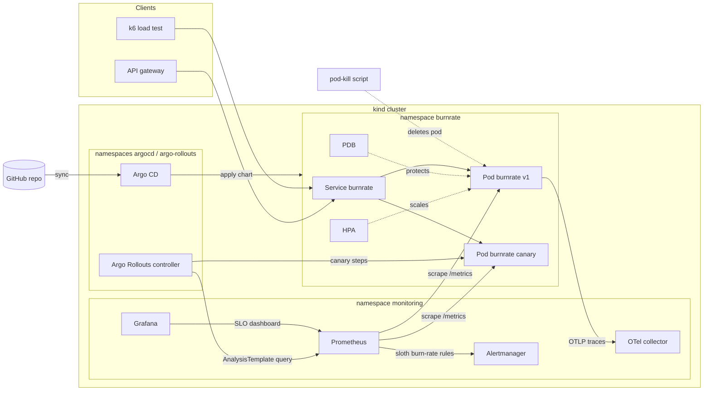
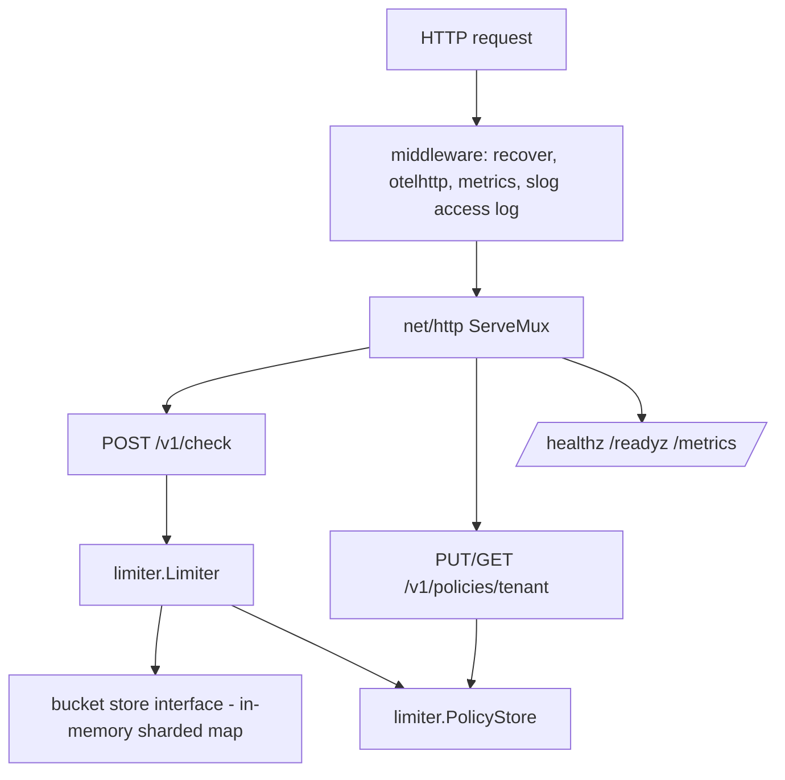

# BurnRate - Build Plan

## Architecture

### Service internals

The service is a single static Go binary. `limiter` is a pure package with an
injectable clock so the token-bucket math is unit-tested without sleeps.
The bucket store is an interface so a Redis adapter can be added later without
touching handlers.

## Data model

| Entity | Fields | Notes |
| --- | --- | --- |
| Policy | `tenant`, `capacity` (max burst tokens), `refill_per_second` | Default policy from env; overrides held in memory |
| Bucket | `tenant`, `key`, `tokens` (float), `updated_at` | Created lazily on first check; idle buckets evicted by a janitor |
| Decision | `allowed`, `remaining`, `limit`, `retry_after_ms` | Returned by `/v1/check`; denial is a normal 200 response, not an error |

Check request: `{"tenant":"acme","key":"card-auth","cost":1}`.

## Telemetry contract

| Signal | Name | Labels |
| --- | --- | --- |
| Counter | `http_requests_total` | `route`, `method`, `code` |
| Histogram | `http_request_duration_seconds` | `route`, `method` |
| Counter | `burnrate_decisions_total` | `decision` (allowed, denied) |
| Gauge | `burnrate_active_buckets` | none |
| Gauge | `burnrate_build_info` | `version` |
| Trace | span per request (otelhttp) plus `limiter.Check` child span | `tenant`, `allowed` attributes |
| Log | JSON access log line per request | `trace_id`, `route`, `status`, `duration_ms` |

Tenant is deliberately not a metric label to keep cardinality bounded.

## SLOs

| SLO | SLI | Objective |
| --- | --- | --- |
| Availability | non-5xx responses on `/v1/check` / all responses | 99.9% over 30d |
| Latency | `/v1/check` requests under 100 ms / all requests | 99% over 30d |

Specs live in `slo/burnrate.sloth.yaml`; `make slo` runs sloth to produce
`deploy/helm/burnrate/files/slo-rules.yaml`, which the chart ships as a
`PrometheusRule`. CI regenerates and fails on drift.

## Milestones (today)

1. Docs: this plan and `PRODUCT.md`.
2. Go service: limiter package with tests, HTTP API with tests, telemetry.
3. Dockerfile (distroless, non-root) and `docker-compose.yml` with Prometheus,
   Grafana and an OTel collector.
4. Helm chart: Deployment or Rollout, Service, HPA, PDB, ServiceMonitor,
   AnalysisTemplate, PrometheusRule, dashboard ConfigMap.
5. SLO specs, generated rules, Grafana dashboard JSON.
6. Argo CD app-of-apps manifests.
7. k6 load test and pod-kill chaos script.
8. CI: lint, test, helm lint, SLO drift check, Docker build plus Trivy, kind e2e
   smoke (install chart, check endpoint, pod-kill recovery).
9. README with architecture, burn-rate math, "what broke and how I fixed it".

## Test strategy

| Layer | Tool | Runs where |
| --- | --- | --- |
| Token-bucket math, policy store, janitor | `go test` with a fake clock | locally and CI |
| HTTP handlers, middleware, metrics output | `net/http/httptest` | locally and CI (`-race`) |
| Server lifecycle (graceful shutdown, readiness flip) | real listener in test | locally and CI |
| Chart correctness | `helm lint`, `helm template` against several values sets | locally and CI |
| SLO rules | sloth generate, diff against committed file | CI |
| Image | Docker build, Trivy scan (HIGH, CRITICAL) | CI |
| End to end | kind cluster, chart install, smoke script, pod-kill chaos | CI (helm/kind-action) and `make e2e` locally |
| Load and autoscaling | k6 against kind with metrics-server | `make load` locally |

## Future work (deferred)

- **AWS EKS** cluster provisioned with **Terraform** (VPC, node groups, IRSA).
- **Azure AKS** as a second target with the same chart.
- Managed observability adapters: Amazon Managed Prometheus, Amazon Managed
  Grafana, Azure Monitor managed Prometheus.
- Container registry push (ECR/ACR/GHCR) and image signing with cosign.
- Public live link via a cloud load balancer and DNS.
- Redis-backed bucket store for globally consistent limits across replicas.
- Loki log aggregation in the kind stack (logs are JSON on stdout and ready to ship).
- Run inside the full opentelemetry-demo cluster as an extra service.
- Chaos Mesh or Litmus experiments beyond pod-kill (network latency, CPU stress).
